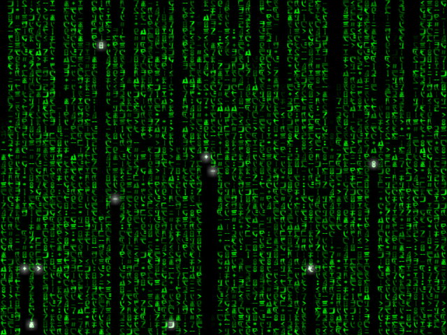

# ZZScreensavers 1.2 - classic AmigaOS 3.x / ZZ9000 / XACP

ZZScreensavers combines Earth, Julia, Solar Winds and the new MatrixView digital rain. Rendering runs on the ZZ9000 Cortex-A9 Core1; Solar Winds and Digital Rain also use RasterIX in the FPGA. The 68k handles display and input integration.

| Executable | Feature | Firmware |
|---|---|---|
| `ZZScreensaverE` | Rotating textured Earth, 640x480 | XX19b or later |
| `ZZScreensaverJ` | Animated Julia fractal, 320x240 | XX19b or later |
| `ZZScreensaverS` | Solar Winds, RasterIX, 640x480 RGB565 | XX19d-RIX |
| `ZZScreensaverR` | Digital Rain, Core1 + RasterIX, 640x480 RGB565 | XX19d-RIX or later; reported tests on XX19e-RIX |
| `ZZScreensaverHotkeys` | Optional Commodities hotkeys, version 1.3 | Depends on selected saver |

## Digital Rain

MatrixView by Alex Zolotov, with changes by Tugrul Galatali and the MPlayer port by Pigeon. Core1 draws the character cells directly into the framebuffer; RasterIX blends the flares.

| Preset | Grid | Cell size |
|---|---|---|
| 1 | 80 x 60 | 8 x 8 |
| 2 (default) | 64 x 48 | 10 x 10 |
| 3 | 40 x 30 | 16 x 16 |

```text
ZZScreensaverR
ZZScreensaverR PRESET 1
ZZScreensaverR PRESET 3
```



The supplied hardware measurements on an A4000/060 with XX19e-RIX report 59.2, 59.4 and 59.5 frames/s for presets 1, 2 and 3 respectively, over 600 frames per preset. These are not guarantees for other configurations. The image above is a host-rendered preview, not an Amiga screenshot.

## Installation and hotkeys

The complete 1.2 LHA package includes all four savers and Hotkeys; no previous installation is required. Quit the old commodity in Exchange if running, copy all five executables to `C:`, then restart the commodity or reboot. Keep the following line in `S:User-Startup`:

```text
Run >NIL: C:ZZScreensaverHotkeys
```

| Shortcut | Saver |
|---|---|
| Ctrl-Alt-E | Earth |
| Ctrl-Alt-J | Julia |
| Ctrl-Alt-S | Solar Winds (random preset 1, 2, 3, 4 or 6) |
| Ctrl-Alt-R | Digital Rain (random preset 1, 2 or 3) |

The random selections avoid repeating the last accepted preset for the same saver. Hotkeys is a manual shortcut manager, not an idle-time blanker. Only one dynamically loaded Core1 application may run at a time. Wait for a saver to close before launching another. Disable other screen blankers while Digital Rain is running. Digital Rain exits on keyboard/mouse activity or when its screen is no longer in front.

## Solar Winds presets

| Preset | Name |
|---|---|
| 1 | Regular (default) |
| 2 | Cosmic Strings |
| 3 | Cold Pricklies |
| 4 | Space Fur |
| 5 | Jiggly (manual only) |
| 6 | Undertow |

```text
ZZScreensaverS PRESET 6
ZZScreensaverS DEBUG PRESET 3 > RAM:ZZSW_3.txt
```

## Requirements and downloads

Classic AmigaOS 3.x, MNT ZZ9000, Picasso96 and a matching XACP `zz9000.card` driver. RasterIX requires XX19d-RIX or later. See the [firmware release](https://github.com/Xanxi-Amiga/XACP-ZZ9000/releases/tag/XX19d-RIX).

- [ZZScreensavers 1.2](https://github.com/Xanxi-Amiga/XACP-ZZ9000/releases/tag/ZZScreensavers-1.2): complete LHA binary package (`ZZScreensavers-1.2.lha`) and corresponding Digital Rain GPL source.
- [ZZScreensavers 1.1](https://github.com/Xanxi-Amiga/XACP-ZZ9000/releases/tag/ZZScreensavers-1.1): original Earth, Julia and Solar Winds binaries, icons, and corresponding Solar Winds GPL source (unchanged).
- [Digital Rain source and build instructions](source/MatrixRain/README.md).
- [Solar Winds source](source/SolarWinds/).

## Licensing and credits

Earth, Julia and the separate Hotkeys commodity remain Xanxi proprietary freeware. Solar Winds (Terence M. Welsh) and Digital Rain (MatrixView) are separate GPL-2.0-or-later programs; their corresponding source is provided. 0BSD support components retain their original notices. NASA imagery has separate credits. See [component licensing](LICENSE_ZZSCREENSAVER.txt), [third-party credits](THIRD_PARTY_LICENSES.txt), and the original source notices.

RasterIX GPU by ToNi3141; MNT ZZ9000 by MNT Research GmbH. This is an independent project.
